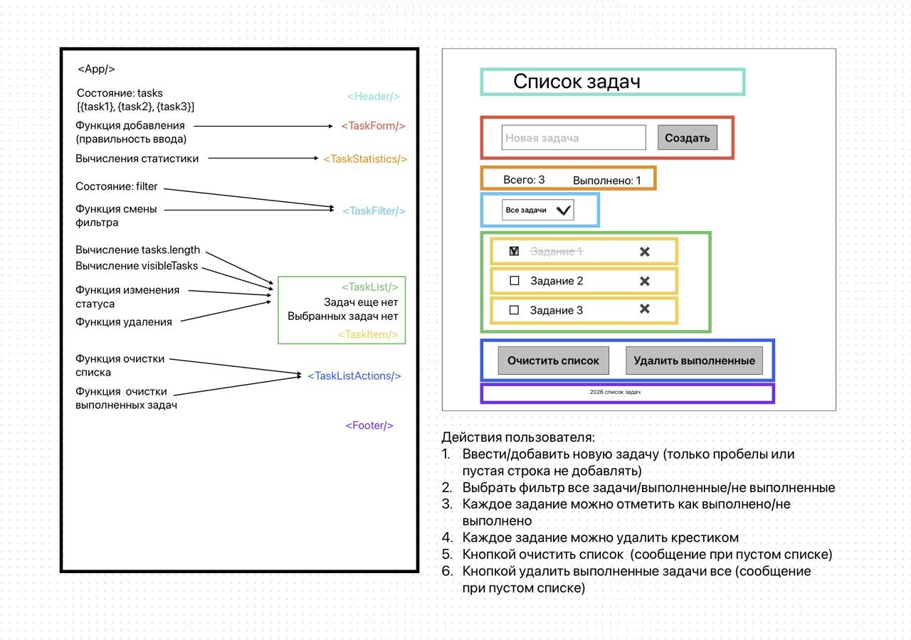

# Task Manager

Небольшой менеджер задач на React. Домашнее задание HW_42, выполнены основная часть, дополнительное задание и задание повышенной сложности (ADV).

## Возможности

- Добавление задачи через форму. Пустая строка и строка из одних пробелов не добавляются, вместо этого появляется сообщение об ошибке.
- Отметка задачи выполненной и возврат в невыполненные.
- Удаление отдельной задачи.
- Статистика: сколько всего задач и сколько выполнено.
- Фильтр: все, выполненные, невыполненные.
- Удаление только выполненных задач.
- Очистка всего списка.
- Сообщения о пустом списке:
  - «No tasks yet» — задач нет совсем;
  - «No tasks selected» — задачи есть, но ни одна не подходит под фильтр.

## Схема проектирования

Перед реализацией я набросала интерфейс, описала действия пользователя
и определила, какие данные и обработчики передаются компонентам через пропсы.



## Структура проекта

```text
src/
├── App.jsx                 # состояние и вся логика
├── App.css                 # стили компонентов
├── index.css               # базовые стили и цветовые переменные
├── data/
│   └── initialTasks.js     # начальные задачи
└── components/
    ├── Header.jsx
    ├── TaskForm.jsx        # форма добавления (локальное состояние поля и ошибки)
    ├── TaskStatistics.jsx
    ├── TaskFilter.jsx      # выпадающий список фильтра
    ├── TaskList.jsx        # список и пустые сообщения
    ├── TaskItem.jsx        # одна задача: чекбокс, название, удаление
    ├── TaskListActions.jsx # «Clear All» и «Clear Completed»
    └── Footer.jsx
```

## Запуск

```bash
npm install
npm run dev
```

